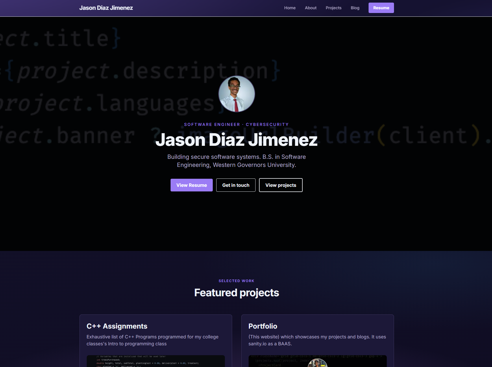

# Personal Website

**Live Website:** [https://jasondiaz.dev](https://jasondiaz.dev)

**GitHub Repository:** [VulpoTheDev/Website](https://github.com/VulpoTheDev/Website)



## About the Project

This is the sixth major version of my personal website. For this version, I wanted to take a different approach by focusing on simplicity, maintainability, and a cleaner design.

Unlike previous versions, which featured more complex layouts and functionality, this version focuses on providing a straightforward experience with dedicated pages for each section rather than placing everything on the homepage.

I also introduced Tailwind CSS for styling and integrated Sanity.io as a headless CMS to manage my projects and blog posts without having to manually update the website's code.

Additionally, I decided to move away from some of the furry-themed elements that were present in previous versions to give the website a more professional appearance.

## What's New in Version 6

- **Redesigned Interface:** A cleaner and more minimal design with improved navigation.
- **Dedicated Pages:** Each section now has its own page instead of being displayed entirely on the homepage.
- **Updated Branding:** Simplified the website's visual identity to focus more on my professional background and projects.

## Tech Stack

- **Next.js:** React framework used to build the website.
- **TypeScript:** Provides static typing for improved maintainability.
- **Tailwind CSS:** Utility-first CSS framework used for styling.
- **Sanity.io:** Headless CMS used to manage projects and blog content.

## Getting Started

### Prerequisites

Make sure you have Node.js and Yarn installed on your system.

### Installation

**1. Clone the repository**

```bash
git clone https://github.com/VulpoTheDev/Website.git
```

**2. Navigate to the project directory**

```bash
cd Website
```

**3. Install dependencies**

```bash
yarn install
```

**4. Start the development server**

```bash
yarn dev
```

Once the development server is running, open [http://localhost:3000](http://localhost:3000) in your browser to view the website.

## Project Background

My personal website has gone through six major revisions as I've continued to learn and experiment with different web development technologies.

Version 6 represents a shift away from adding unnecessary complexity and toward building a simpler website that is easier to maintain, navigate, and expand.

The project also gave me an opportunity to work with Tailwind CSS and explore integrating a headless CMS into a Next.js application.
